# TÀI LIỆU HƯỚNG DẪN SỬ DỤNG HỆ THỐNG QUẢN LÝ TRƯỜNG TIỂU HỌC TÍCH HỢP KPI (EDUPRIMARY-KPI)

**Hệ thống Quản lý Toàn diện Trường Tiểu học & Đánh giá Hiệu suất Viên chức Chuẩn Quốc gia**  
*Phiên bản phát hành: 2.4.0 — Năm học 2026 - 2027*  
*Áp dụng: Toàn thể Cán bộ quản lý (BGH), Giáo viên chủ nhiệm (GVCN), Giáo viên bộ môn (GVBM), Kế toán, Nhân viên y tế, Văn thư và Phụ huynh học sinh*

---

## MỤC LỤC TỔNG QUAN

1. [GIỚI THIỆU TỔNG QUAN VÀ CƠ SỞ PHÁP LÝ](#1-giới-thiệu-tổng-quan-và-cơ-sở-pháp-lý)
   - [1.1 Giới thiệu Hệ thống EduPrimary-KPI](#11-giới-thiệu-hệ-thống-eduprimary-kpi)
   - [1.2 Căn cứ Pháp lý Bắt buộc](#12-căn-cứ-pháp-lý-bắt-buộc)
   - [1.3 Danh mục 10 Phân hệ Nghiệp vụ Cốt lõi](#13-danh-mục-10-phân-hệ-nghiệp-vụ-cốt-lõi)
2. [HƯỚNG DẪN TRUY CẬP VÀ PHÂN QUYỀN HỆ THỐNG](#2-hướng-dẫn-truy-cập-và-phân-quyền-hệ-thống)
   - [2.1 Đăng nhập Hệ thống Quản trị](#21-đăng-nhập-hệ-thống-quản-trị)
   - [2.2 Bảng điều khiển Trung tâm (Dashboard)](#22-bảng-điều-khiển-trung-tâm-dashboard)
   - [2.3 Ma trận Phân quyền 7 Vai trò (RBAC)](#23-ma-trận-phân-quyền-7-vai-trò-rbac)
3. [HƯỚNG DẪN DÀNH CHO BAN GIÁM HIỆU (BGH)](#3-hướng-dẫn-dành-cho-ban-giám-hiệu-bgh)
   - [3.1 Giám sát Định mức Tiết dạy Chuẩn 805 Tiết (TT 05/2025)](#31-giám-sát-định-mức-tiết-dạy-chuẩn-805-tiết-tt-052025)
   - [3.2 Phê duyệt Kế hoạch Bài dạy Điện tử (CV 2345 & STEM TT 86)](#32-phê-duyệt-kế-hoạch-bài-dạy-điện-tử-cv-2345--stem-tt-86)
   - [3.3 Quản lý Thời khóa biểu & Chống Trùng Tiết](#33-quản-lý-thời-khóa-biểu--chống-trùng-tiết)
   - [3.4 Đánh giá KPI 360 & Khống chế Trần 20% Xuất sắc (NĐ 90 & NĐ 48)](#34-đánh-giá-kpi-360--khống-chế-trần-20-xuất-sắc-nđ-90--nđ-48)
   - [3.5 Đóng băng Snapshot Học bạ & Ký số SmartCA Kèm TSA Timestamp](#35-đóng-băng-snapshot-học-bạ--ký-số-smartca-kèm-tsa-timestamp)
   - [3.6 Giám sát Cổng Tích hợp Sandbox Quốc gia](#36-giám-sát-cổng-tích-hợp-sandbox-quốc-gia)
4. [HƯỚNG DẪN DÀNH CHO GIÁO VIÊN CHỦ NHIỆM (GVCN)](#4-hướng-dẫn-dành-cho-giáo-viên-chủ-nhiệm-gvcn)
   - [4.1 Quản lý Hồ sơ Học sinh & Lớp học](#41-quản-lý-hồ-sơ-học-sinh--lớp-học)
   - [4.2 Rà soát Digital Consent Bảo vệ Trẻ em (Điều 20 NĐ 13/2023)](#42-rà-soát-digital-consent-bảo-vệ-trẻ-em-điều-20-nđ-132023)
   - [4.3 Đánh giá Phẩm chất & Năng lực Học sinh (TT 27/2020 & TT 89/2026)](#43-đánh-giá-phẩm-chất--năng-lực-học-sinh-tt-272020--tt-892026)
   - [4.4 Tổng hợp Học bạ Số và Ký số Lớp Chủ nhiệm](#44-tổng-hợp-học-bạ-số-và-ký-số-lớp-chủ-nhiệm)
   - [4.5 Quản lý Điểm danh & Báo suất Bán trú](#45-quản-lý-điểm-danh--báo-suất-bán-trú)
5. [HƯỚNG DẪN DÀNH CHO GIÁO VIÊN BỘ MÔN (GVBM)](#5-hướng-dẫn-dành-cho-giáo-viên-bộ-môn-gvbm)
   - [5.1 Soạn thảo & Nộp Kế hoạch Bài dạy Chuẩn CV 2345](#51-soạn-thảo--nộp-kế-hoạch-bài-dạy-chuẩn-cv-2345)
   - [5.2 Nhập Điểm Kiểm tra Định kỳ & Trợ lý Nhận xét AI Copilot](#52-nhập-điểm-kiểm-tra-định-kỳ--trợ-lý-nhận-xét-ai-copilot)
   - [5.3 Tra cứu Thời khóa biểu & Lịch Báo giảng](#53-tra-cứu-thời-khóa-biểu--lịch-báo-giảng)
   - [5.4 Tham gia Đánh giá Đồng nghiệp Trong Đánh giá KPI 360](#54-tham-gia-đánh-giá-đồng-nghiệp-trong-đánh-giá-kpi-360)
6. [HƯỚNG DẪN DÀNH CHO KẾ TOÁN & TÀI CHÍNH](#6-hướng-dẫn-dành-cho-kế-toán--tài-chính)
   - [6.1 Lập Kế hoạch Thực đơn Bán trú & Cân đối Dinh dưỡng Kcal, P:L:G](#61-lập-kế-hoạch-thực-đơn-bán-trú--cân-đối-dinh-dưỡng-kcal-plg)
   - [6.2 Tự động Tính Tiền Ăn Bán trú & Quy tắc Cắt cơm Trước 08:00](#62-tự-động-tính-tiền-ăn-bán-trú--quy-tắc-cắt-cơm-trước-0800)
   - [6.3 Thu Phí Tự động Qua Mã VietQR Động Chuẩn EMVCo](#63-thu-phí-tự-động-qua-mã-vietqr-động-chuẩn-emvco)
   - [6.4 Xuất Hóa đơn Điện tử Hợp pháp (NĐ 123/2020/NĐ-CP - Ký hiệu 1C26TAA)](#64-xuất-hóa-đơn-điện-tử-hợp-pháp-nđ-1232020nđ-cp---ký-hiệu-1c26taa)
   - [6.5 Quyết toán Thù lao Dạy Thừa giờ (Thông tư 05/2025/TT-BGDĐT)](#65-quyết-toán-thù-lao-dạy-thừa-giờ-thông-tư-052025tt-bgdđt)
7. [HƯỚNG DẪN DÀNH CHO NHÂN VIÊN Y TẾ HỌC ĐƯỜNG](#7-hướng-dẫn-dành-cho-nhân-viên-y-tế-học-đường)
   - [7.1 Theo dõi Nhân trắc học & Phân loại Thể trạng BMI](#71-theo-dõi-nhân-trắc-học--phân-loại-thể-trạng-bmi)
   - [7.2 Khám Chuyên khoa Thị lực, Nha học đường & Nhật ký Y tế](#72-khám-chuyên-khoa-thị-lực-nha-học-đường--nhật-ký-y-tế)
   - [7.3 Quy trình Tiếp nhận Đơn thuốc & Cấp phát Thuốc theo Yêu cầu](#73-quy-trình-tiếp-nhận-đơn-thuốc--cấp-phát-thuốc-theo-yêu-cầu)
   - [7.4 Quy trình Niêm phong & Lưu mẫu Thức ăn 24H (QĐ 1246/QĐ-BYT)](#74-quy-trình-niêm-phong--lưu-mẫu-thức-ăn-24h-qđ-1246qđ-byt)
8. [HƯỚNG DẪN DÀNH CHO VĂN THƯ & QUẢN TRỊ HỆ THỐNG](#8-hướng-dẫn-dành-cho-văn-thư--quản-trị-hệ-thống)
   - [8.1 Khởi tạo Danh mục Năm học, Khối lớp & Phòng học](#81-khởi-tạo-danh-mục-năm-học-khối-lớp--phòng-học)
   - [8.2 Quản lý Nhân sự Giáo viên & Phân công Chuyên môn](#82-quản-lý-nhân-sự-giáo-viên--phân-công-chuyên-môn)
   - [8.3 Tiếp nhận Hồ sơ Học sinh & Xác thực VNeID Mức 2](#83-tiếp-nhận-hồ-sơ-học-sinh--xác-thực-vneid-mức-2)
   - [8.4 Đồng bộ Dữ liệu CSDL Ngành MOET Qua Cơ chế Outbox](#84-đồng-bộ-dữ-liệu-csdl-ngành-moet-qua-cơ-chế-outbox)
   - [8.5 Bảo mật, Sao lưu Cơ sở Dữ liệu & Phục hồi Thảm họa](#85-bảo-mật-sao-lưu-cơ-sở-dữ-liệu--phục-hồi-thảm-họa)
9. [HƯỚNG DẪN DÀNH CHO PHỤ HUYNH HỌC SINH](#9-hướng-dẫn-dành-cho-phụ-huynh-học-sinh)
   - [9.1 Xác thực Tài khoản Phụ huynh & Ký Digital Consent](#91-xác-thực-tài-khoản-phụ-huynh--ký-digital-consent)
   - [9.2 Theo dõi Kết quả Học tập, Rèn luyện & Sức khỏe Của Con](#92-theo-dõi-kết-quả-học-tập-rèn-luyện--sức-khỏe-của-con)
   - [9.3 Báo Cắt Suất Ăn Bán trú Tự động Trước 08:00](#93-báo-cắt-suất-ăn-bán-trú-tự-động-trước-0800)
   - [9.4 Thanh toán Tiền ăn, Học phí Không Dùng Tiền Mặt (VietQR)](#94-thanh-toán-tiền-ăn-học-phí-không-dùng-tiền-mặt-vietqr)
   - [9.5 Gửi Yêu cầu Uống thuốc & Tương tác Với Cán bộ Y tế](#95-gửi-yêu-cầu-uống-thuốc--tương-tác-với-cán-bộ-y-tế)
10. [PHỤ LỤC: BẢNG TRA CỨU MÃ LỖI VÀ RUNBOOK VẬN HÀNH](#10-phụ-lục-bảng-tra-cứu-mã-lỗi-và-runbook-vận-hành)
    - [10.1 Bảng Tra cứu Mã Lỗi HTTP Nghiệp vụ](#101-bảng-tra-cứu-mã-lỗi-http-nghiệp-vụ)
    - [10.2 Runbook Vận hành Hệ thống Định kỳ](#102-runbook-vận-hành-hệ-thống-định-kỳ)
    - [10.3 Hỗ trợ Kỹ thuật & Khắc phục Sự cố 24/7](#103-hỗ-trợ-kỹ-thuật--khắc-phục-sự-cố-247)

---

# 1. GIỚI THIỆU TỔNG QUAN VÀ CƠ SỞ PHÁP LÝ

## 1.1 Giới thiệu Hệ thống EduPrimary-KPI

**EduPrimary-KPI** là giải pháp phần mềm quản lý trường tiểu học thế hệ mới, được thiết kế chuyên biệt nhằm giải quyết triệt để bài toán số hóa toàn diện hoạt động giảng dạy, quản trị học sinh, tài chính bán trú, y tế học đường và đánh giá hiệu suất cán bộ viên chức (KPI 360 độ).

Hệ thống được xây dựng trên nền tảng kiến trúc **Go Clean Architecture** kết hợp hệ quản trị giao diện **GoAdmin**, mang lại năng lực xử lý vượt trội, khả năng chịu tải hàng chục nghìn giao dịch đồng thời với độ trễ phản hồi sub-millisecond, hoàn toàn miễn nhiễm với rủi ro chậm trễ trong các đợt cao điểm nhập điểm và quyết toán cuối năm học.

## 1.2 Căn cứ Pháp lý Bắt buộc

Toàn bộ các quy tắc nghiệp vụ trong EduPrimary-KPI được lập trình cố định (hardcoded business logic) và bảo vệ bằng các ràng buộc kiểm thử tự động, tuân thủ nghiêm ngặt hệ thống văn bản quy phạm pháp luật hiện hành của Nhà nước và Bộ Giáo dục & Đào tạo:

| Văn bản Pháp lý | Cơ quan Ban hành | Nội dung Quy chuẩn Nghiệp vụ Ràng buộc Trong Hệ thống |
|:---|:---|:---|
| **Thông tư 05/2025/TT-BGDĐT** | Bộ Giáo dục & Đào tạo | Quy định định mức tiết dạy giáo viên tiểu học chuẩn **805 tiết/năm** (35 tuần thực dạy, tương đương 23 tiết/tuần). Giảm trừ chính xác **4 tiết/tuần** cho Giáo viên chủ nhiệm (thay thế quy định 3 tiết cũ tại TT 28/2009). Giảm 3 tiết/tuần cho Tổ trưởng chuyên môn, 1 tiết/tuần cho Tổ phó, 3 tiết/tuần cho nữ giáo viên nuôi con dưới 12 tháng tuổi. Tiết dạy thừa giờ tính theo nguyên tắc không âm. |
| **Nghị định 90/2020/NĐ-CP & Nghị định 48/2023/NĐ-CP** | Chính phủ | Quy định về đánh giá, xếp loại chất lượng cán bộ, công chức, viên chức. Cơ cấu tỷ trọng đánh giá 4 chiều: Tự động hệ thống **40%**, Ban giám hiệu **30%**, Đồng nghiệp **15%**, Phụ huynh **15%**. Khống chế trần không quá **20%** viên chức đạt mức "Hoàn thành xuất sắc nhiệm vụ". Điều kiện bắt buộc để đạt xuất sắc là phải có Sáng kiến kinh nghiệm / Đề tài nghiên cứu khoa học được công nhận. Áp dụng cơ chế **Điểm liệt** đối với các trường hợp bị kỷ luật, vi phạm dạy thêm học thêm, hoặc để xảy ra tai nạn trường học nghiêm trọng. |
| **Thông tư 27/2020/TT-BGDĐT & Thông tư 89/2026/TT-BGDĐT** | Bộ Giáo dục & Đào tạo | Quy định đánh giá học sinh tiểu học. Áp dụng cơ chế chuyển tiếp thời gian thực (**Strategy Versioning**): Trước ngày **01/12/2026** áp dụng Thông tư 27/2020; từ ngày **01/12/2026** trở đi áp dụng Thông tư 89/2026. Xếp loại môn học 3 mức (HTT/HT/CHT), đánh giá phẩm chất và năng lực theo 3 mức (T/Đ/C), bảo lưu tuyệt đối lịch sử học bạ. |
| **Nghị định 13/2023/NĐ-CP (Điều 20)** | Chính phủ | Bảo vệ dữ liệu cá nhân trẻ em. Hệ thống bắt buộc phải thu thập và lưu vết chữ ký điện tử của phụ huynh/người giám hộ (**Digital Consent**) trước khi kích hoạt hồ sơ học sinh. Nghiêm cấm kích hoạt hồ sơ khi thiếu sự đồng thuận (hệ thống chặn với mã lỗi HTTP 422). |
| **Công văn 2345/BGDĐT-GDTH & Thông tư 86/BGDĐT** | Bộ Giáo dục & Đào tạo | Hướng dẫn xây dựng kế hoạch bài dạy (giáo án) cấp tiểu học chuẩn 4 hoạt động học tập (Khởi động -> Khám phá -> Luyện tập -> Vận dụng) và tích hợp bài học STEM. Quy trình phê duyệt điện tử 3 cấp: Soạn thảo -> Tổ trưởng kiểm duyệt -> BGH phê duyệt. |
| **Quyết định 1246/QĐ-BYT** | Bộ Y tế | Hướng dẫn thực hiện chế độ kiểm thực 3 bước và lưu mẫu thức ăn đối với cơ sở kinh doanh dịch vụ ăn uống và bếp ăn tập thể trường học. Bắt buộc lưu mẫu thức ăn trong 24 giờ ở nhiệt độ $4^\circ\text{C}$ kèm sổ bàn giao niêm phong. |
| **Nghị định 123/2020/NĐ-CP & Thông tư 78/2021/TT-BTC** | Chính phủ, Bộ Tài chính | Quy định về hóa đơn, chứng từ điện tử. Hệ thống tích hợp cổng phát hành hóa đơn điện tử cho các khoản thu học phí và tiền ăn bán trú, ký hiệu mẫu số hóa đơn `1C26TAA` có mã cơ quan thuế. |
| **Luật Giao dịch điện tử 2023 & Thông tư 22/2020/TT-BTTTT** | Quốc hội, Bộ TT&TT | Ký số tài liệu điện tử, học bạ số bằng chứng thư số công cộng SmartCA chuẩn CMS/PKCS#7 kèm gắn dấu thời gian quốc gia (**TSA Timestamp**) chống chối bỏ. |

## 1.3 Danh mục 10 Phân hệ Nghiệp vụ Cốt lõi

EduPrimary-KPI bao gồm 10 phân hệ liên kết chặt chẽ qua cơ sở dữ liệu quan hệ PostgreSQL chuẩn hóa:

1. **Phân hệ Quản lý Hồ sơ Học sinh & Digital Consent (Decree 13):** Quản lý định danh học sinh, liên kết phụ huynh, kiểm soát đồng thuận dữ liệu điện tử.
2. **Phân hệ Đánh giá Học sinh & Phiên bản Thông tư (TT 27 -> TT 89):** Sổ điểm điện tử, nhận xét phẩm chất - năng lực, trợ lý AI gợi ý nhận xét.
3. **Phân hệ Nhân sự, Giáo viên & Kế hoạch Bài dạy (TT 05 & CV 2345):** Định mức tiết dạy, kiểm soát thời khóa biểu chống trùng tiết, phê duyệt giáo án điện tử.
4. **Phân hệ Dinh dưỡng Bán trú & Thực đơn Thông minh (QĐ 1246):** Lập thực đơn tự động cân bằng Kcal/P:L:G, quản lý lưu mẫu thức ăn 24h, hoàn trả tiền ăn tự động.
5. **Phân hệ Y tế Học đường & Sức khỏe Học sinh:** Biểu đồ thể trạng BMI, thị lực học đường, nha khoa, quản lý tiếp nhận và cho uống thuốc theo đơn.
6. **Phân hệ Quản lý Lớp học & Phòng chức năng:** Cơ cấu khối lớp 1 đến lớp 5, phòng tin học, ngoại ngữ, STEM, phân bổ giáo viên chủ nhiệm.
7. **Phân hệ Thu phí & Thanh toán Điện tử (VietQR & NĐ 123):** Thu học phí qua VietQR động chuẩn EMVCo, phát hành hóa đơn điện tử tự động gạch nợ.
8. **Phân hệ Đánh giá Hiệu suất KPI 360 Viên chức (NĐ 90 & NĐ 48):** Tính điểm 4 chiều, lọc điểm liệt, tự động áp trần 20% danh hiệu Hoàn thành xuất sắc.
9. **Phân hệ Học bạ Số & Ký số Bất biến (SmartCA + TSA):** Đóng băng bản ghi Snapshot cuối năm, ký số CMS PKCS#7 chống sửa đổi lịch sử.
10. **Phân hệ Cổng Tích hợp Dịch vụ Công Quốc gia (Sandbox Stubs):** Tích hợp VNeID Mức 2, SmartCA, CSDL Ngành Bộ GD&ĐT, Napas VietQR, Hóa đơn điện tử.

---

# 2. HƯỚNG DẪN TRUY CẬP VÀ PHÂN QUYỀN HỆ THỐNG

## 2.1 Đăng nhập Hệ thống Quản trị

Mọi người dùng được cấp tài khoản truy cập vào hệ thống quản trị qua giao diện Web chuẩn Responsive tương thích máy tính để bàn, máy tính bảng và điện thoại thông minh:

- **Địa chỉ truy cập nội bộ:** `http://localhost:8098/admin/login` (hoặc tên miền máy chủ của nhà trường).
- **Tên đăng nhập:** Mã định danh cán bộ / giáo viên / nhân viên (Ví dụ: `admin`, `gvcn01`, `gvbm01`, `ketoan01`, `yte01`, `vanthu01`).
- **Mật khẩu:** Khởi tạo mặc định khi bàn giao, người dùng bắt buộc đổi mật khẩu trong lần đăng nhập đầu tiên.

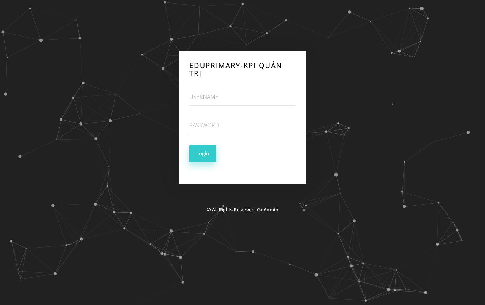

### Các bước thao tác đăng nhập:
1. Nhập **Tên đăng nhập** vào ô `Username`.
2. Nhập **Mật khẩu** vào ô `Password`.
3. Nhấn nút **Đăng nhập (Sign In)**.
4. Hệ thống tự động xác thực chữ ký phiên làm việc (Session Cookie `goadmin_session`), kiểm tra quyền hạn RBAC và chuyển hướng người dùng đến Bảng điều khiển tương ứng.

## 2.2 Bảng điều khiển Trung tâm (Dashboard)

Sau khi xác thực thành công, màn hình Tổng quan Bảng điều khiển trung tâm hiển thị trực quan toàn bộ các chỉ số vận hành trọng yếu của nhà trường:

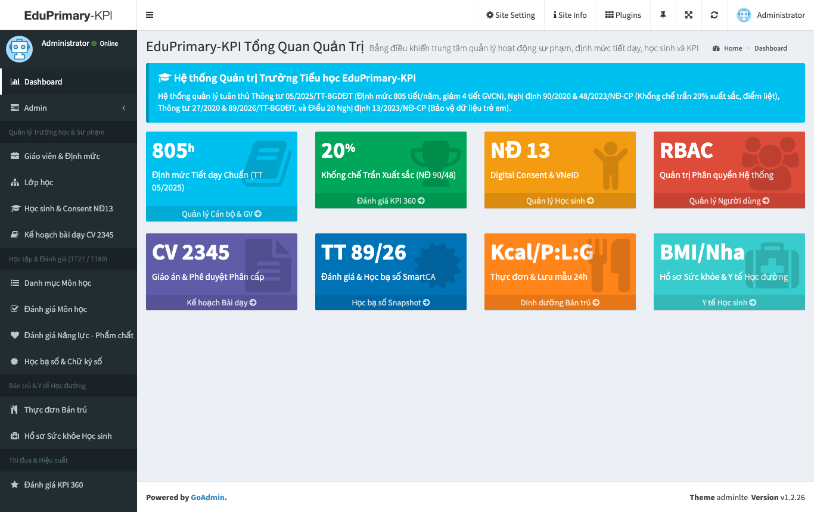

Trên Bảng điều khiển trung tâm, người dùng có thể nhanh chóng theo dõi:
- **Thẻ Định mức Tiết dạy (Thông tư 05/2025):** Tổng số tiết giảng dạy toàn trường, định mức chuẩn 805 tiết/năm, số tiết giảm trừ hợp pháp và tỷ lệ giáo viên có giờ dạy vượt định mức.
- **Thẻ Khống chế Trần KPI 20% (Nghị định 90/2020 & 48/2023):** Tỷ lệ phân bổ xếp loại viên chức, cảnh báo vi phạm trần 20% danh hiệu Xuất sắc để Hội đồng Thi đua kịp thời điều chỉnh.
- **Thẻ Bảo vệ Dữ liệu Trẻ em (Điều 20 Nghị định 13/2023):** Tỷ lệ học sinh đã hoàn tất thu thập Digital Consent từ cha mẹ (Mục tiêu 100% trước khi mở sổ điểm).
- **Thanh menu điều hướng chuyên biệt (Sidebar Navigation):** Cho phép truy cập 1-chạm vào toàn bộ 10 phân hệ nghiệp vụ theo đúng thẩm quyền được phân cấp.

## 2.3 Ma trận Phân quyền 7 Vai trò (RBAC)

Hệ thống thiết lập hàng rào kiểm soát truy cập nghiêm ngặt ở cả lớp giao diện (GoAdmin Menu & Action Buttons) và lớp API Gateway (`internal/api/middleware/rbac.go`):

| Phân hệ / Thao tác | Ban Giám Hiệu (BGH) | GVCN | GVBM | Kế toán | Y tế | Văn thư | Phụ huynh |
|:---|:---:|:---:|:---:|:---:|:---:|:---:|:---:|
| **Xem Bảng điều khiển toàn trường** | Toàn quyền | Giới hạn lớp | Không | Không | Không | Toàn quyền | Không |
| **Phê duyệt Giáo án (CV 2345)** | Duyệt cuối (Approve) | Xem | Soạn & Nộp | Không | Không | Không | Không |
| **Xếp Thời khóa biểu & Chống trùng** | Toàn quyền | Xem | Xem | Không | Không | Hỗ trợ | Không |
| **Quản lý Định mức Tiết dạy (TT 05)** | Phê duyệt | Xem | Xem | Quyết toán | Không | Cập nhật hồ sơ | Không |
| **Nhập Điểm Môn học (TT 27/TT 89)** | Giám sát | Xem lớp mình | Nhập môn phụ trách | Không | Không | Không | Xem điểm con |
| **Đánh giá Phẩm chất & Năng lực** | Giám sát | Nhập lớp mình | Nhận xét phụ | Không | Không | Không | Xem kết quả |
| **Thu thập Digital Consent (NĐ 13)** | Giám sát | Đôn đốc | Không | Không | Không | Kiểm tra hồ sơ | Ký đồng thuận |
| **Thực đơn Bán trú & Calo (QĐ 1246)** | Phê duyệt | Báo vắng lớp | Không | Lập thực đơn | Kiểm tra ATTP | Không | Báo cắt cơm |
| **Khám Sức khỏe & Quản lý Thuốc** | Giám sát | Phối hợp | Không | Không | Toàn quyền | Không | Gửi đơn thuốc |
| **Thu Tiền Ăn & Học phí (VietQR)** | Giám sát | Theo dõi nộp | Không | Quản lý thu | Không | Không | Quét mã trả |
| **Đánh giá KPI 360 & Áp trần 20%** | Đánh giá BGH (30%) & Duyệt trần | Đánh giá đồng nghiệp | Đánh giá đồng nghiệp | Đánh giá đồng nghiệp | Đánh giá đồng nghiệp | Đánh giá đồng nghiệp | Đánh giá PH (15%) |
| **Ký số Học bạ SmartCA + TSA** | Ký duyệt Hiệu trưởng | Ký GVCN | Không | Không | Không | Lưu trữ | Tải bản ký số |
| **Cổng Tích hợp Sandbox Quốc gia** | Quản trị | Không | Không | Thao tác VietQR/HĐĐT | Không | Đồng bộ MOET | Xác thực VNeID |

---

# 3. HƯỚNG DẪN DÀNH CHO BAN GIÁM HIỆU (BGH)

Ban Giám Hiệu (Hiệu trưởng và các Phó Hiệu trưởng) đóng vai trò điều hành cao nhất, chịu trách nhiệm trước pháp luật về tính chính xác của dữ liệu học bạ, công tác thi đua khen thưởng và an toàn trường học.

## 3.1 Giám sát Định mức Tiết dạy Chuẩn 805 Tiết (TT 05/2025)

Theo quy định tại **Thông tư số 05/2025/TT-BGDĐT**, định mức tiết dạy của giáo viên trường tiểu học trong một năm học là **805 tiết dạy** (bao gồm 35 tuần thực dạy, tương đương định mức 23 tiết dạy/tuần).


### Quy trình kiểm tra định mức tiết dạy:
1. Từ thanh menu bên trái, truy cập: **Quản lý Đội ngũ** -> **Danh sách Cán bộ Giáo viên** (`/admin/info/staffs`).
2. Nhấp chọn giáo viên để kiểm tra chi tiết chức danh, ngạch bậc, chức vụ kiêm nhiệm và các chế độ giảm trừ:
   - Giáo viên chủ nhiệm lớp: Hệ thống tự động giảm trừ **4 tiết/tuần** (theo đúng TT 05/2025, trường hợp các hệ thống cũ giảm 3 tiết sẽ bị cảnh báo sai lệch).
   - Tổ trưởng chuyên môn: Giảm trừ **3 tiết/tuần**.
   - Tổ phó chuyên môn: Giảm trừ **1 tiết/tuần**.
   - Nữ giáo viên nuôi con nhỏ dưới 12 tháng tuổi: Giảm trừ **3 tiết/tuần**.
   - Giáo viên kiêm nhiệm tư vấn tâm lý học sinh: Giảm trừ **3 đến 8 tiết/tuần** tùy quy mô trường.
3. Chuyển sang bảng **Báo cáo Định mức Tiết dạy** (`screenshots/03_staffs_teaching_quota.png`):

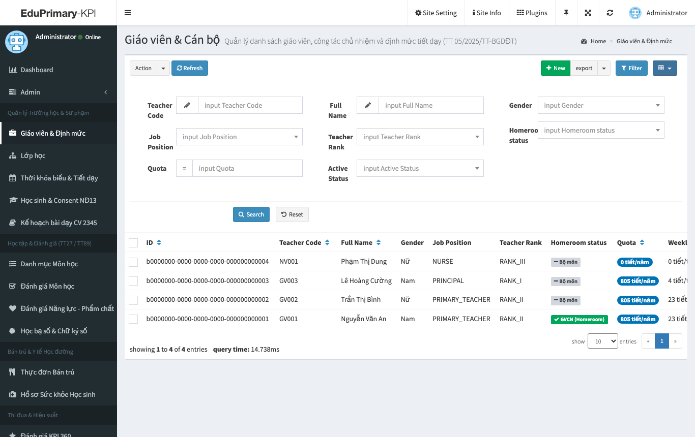

Hệ thống tự động áp dụng công thức toán học bất biến:
$$\text{Định mức thực tế} = 805 - (\text{Tổng số tiết giảm mỗi tuần} \times 35)$$
$$\text{Số tiết thừa giờ} = \max\left(0, \text{Tổng tiết quy đổi thực tế} - \text{Định mức thực tế}\right)$$

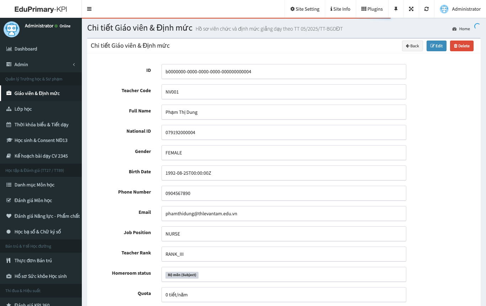

4. Ban Giám Hiệu rà soát cột **Tiết thừa giờ**. Dữ liệu đảm bảo không bao giờ âm, là căn cứ pháp lý để ký duyệt thanh toán thù lao thêm giờ.

## 3.2 Phê duyệt Kế hoạch Bài dạy Điện tử (CV 2345 & STEM TT 86)

Toàn bộ giáo án của giáo viên phải tuân thủ khung 4 hoạt động học tập theo **Công văn số 2345/BGDĐT-GDTH** và các chuyên đề giáo dục STEM theo **Thông tư 86/BGDĐT**.

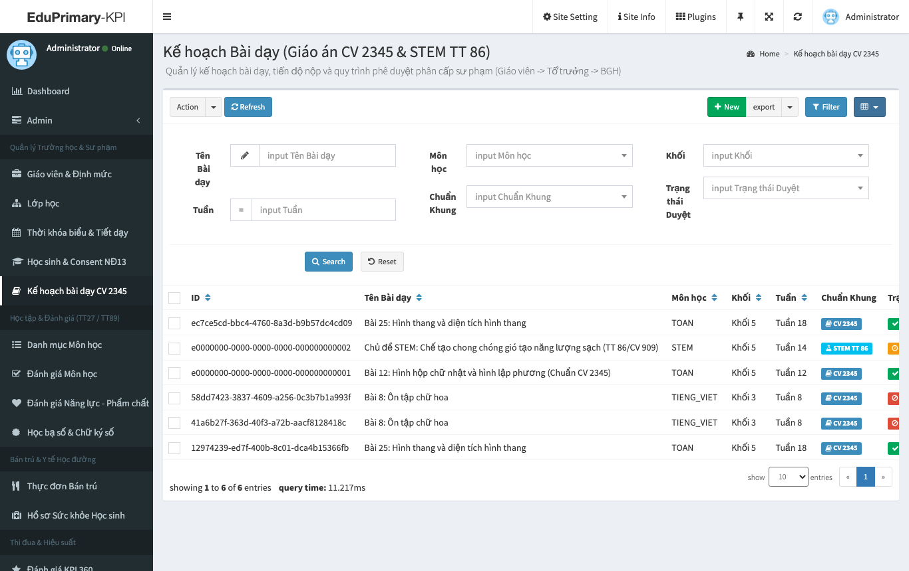

### Các bước phê duyệt kế hoạch bài dạy:
1. Truy cập: **Chuyên môn Tiểu học** -> **Kế hoạch Bài dạy (CV 2345)** (`/admin/info/lesson_plans`).
2. Xem trạng thái phê duyệt trong cột `Trạng thái`:
   - `SUBMITTED`: Giáo viên đã nộp, đang chờ Tổ trưởng chuyên môn thẩm định.
   - `REVIEWED`: Tổ trưởng đã kiểm tra nội dung và ký nháy đồng thuận.
   - `APPROVED`: BGH đã phê duyệt chính thức.
3. Nhấp nút **Xem chi tiết** (`Chi tiết Kế hoạch bài dạy`) để kiểm tra cấu trúc giáo án:

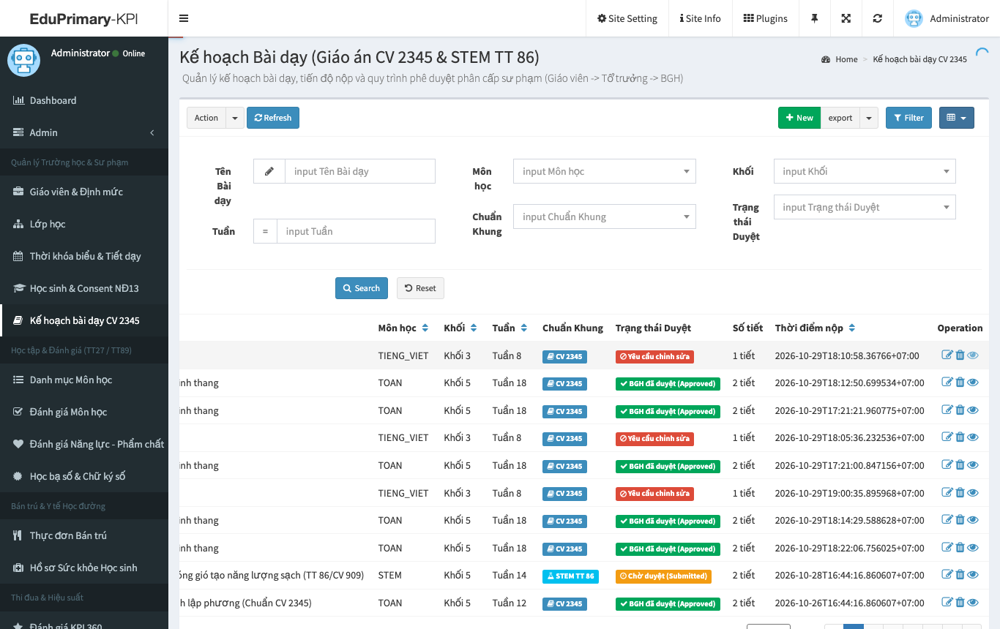

4. Kiểm tra đầy đủ 4 giai đoạn tiến trình hoạt động học tập:
   - *Hoạt động 1:* Khởi động, kết nối trải nghiệm.
   - *Hoạt động 2:* Khám phá, hình thành kiến thức mới.
   - *Hoạt động 3:* Luyện tập, thực hành củng cố.
   - *Hoạt động 4:* Vận dụng, trải nghiệm thực tiễn.
5. Nhấn **Phê duyệt (Approve)** hoặc **Yêu cầu chỉnh sửa (Request Revision)** kèm ghi chú sư phạm cụ thể.

## 3.3 Quản lý Thời khóa biểu & Chống Trùng Tiết

EduPrimary-KPI tích hợp thuật toán phân bổ lịch học thông minh cho 2 buổi/ngày (Sáng 4 tiết, Chiều 3 tiết), cam kết tuyệt đối không xảy ra hiện tượng xung đột giáo viên hoặc phòng học chức năng.

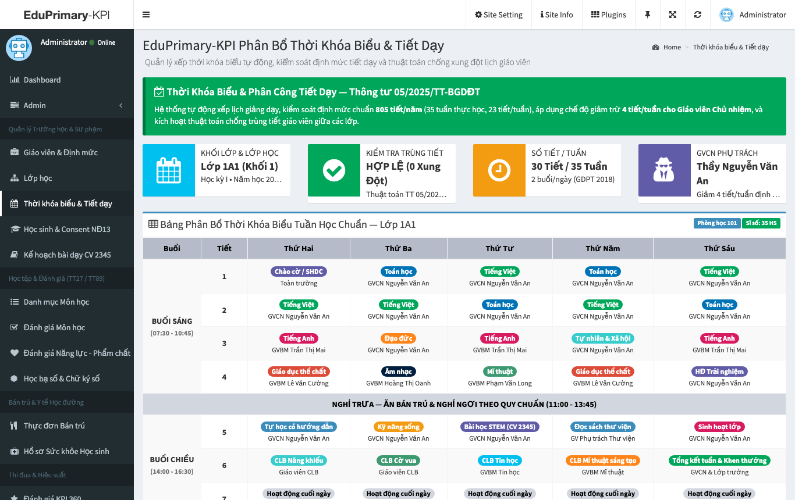

### Cơ chế chống trùng tiết tự động:
- Khi xếp lịch trên giao diện `/admin/timetable` hoặc thông qua API `/api/v1/timetable/slots`, hệ thống kiểm tra chéo ma trận phân công:
  $$\forall (s_1, s_2) \in \text{Schedule}: (s_1.TeacherID = s_2.TeacherID \land s_1.DayOfWeek = s_2.DayOfWeek \land s_1.Period = s_2.Period) \implies \text{Error 409 Conflict}$$
- Nếu giáo viên đã có tiết dạy tại Lớp 1A1 vào Tiết 2 Sáng Thứ 3, hệ thống sẽ **khóa ngay lập tức** và hiển thị cảnh báo lỗi **HTTP 409 Conflict**, ngăn chặn hoàn toàn sai sót bố trí trùng tiết trong thực tế.

## 3.4 Đánh giá KPI 360 & Khống chế Trần 20% Xuất sắc (NĐ 90 & NĐ 48)

Hệ thống thực hiện đánh giá hiệu suất công tác theo nguyên tắc dân chủ, minh bạch và tuân thủ chặt chẽ **Nghị định 90/2020/NĐ-CP** và **Nghị định 48/2023/NĐ-CP**.

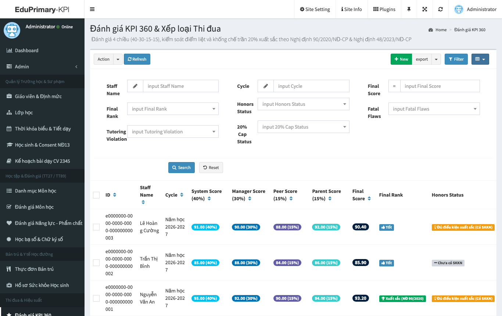

### Cơ chế tính toán và xét duyệt của BGH:
1. Truy cập: **Đánh giá & Thi đua** -> **Đánh giá KPI 360 Viên chức** (`/admin/info/kpi_evaluation_results`).
2. Xem chi tiết bảng điểm 4 nguồn dữ liệu:
   - **Hệ thống tự động chấm (40%):** Dựa trên hồ sơ nộp giáo án đúng hạn, tỷ lệ cập nhật điểm số, tham gia bồi dưỡng chuyên môn.
   - **Ban Giám Hiệu đánh giá (30%):** Dựa trên năng lực quản trị, chất lượng giờ dạy dự giờ, trách nhiệm kỷ cương.
   - **Đồng nghiệp trong tổ chuyên môn đánh giá (15%):** Phiếu nhận xét dân chủ cuối năm học.
   - **Phụ huynh học sinh đánh giá (15%):** Phiếu khảo sát độ hài lòng trực tuyến trên ứng dụng liên lạc.

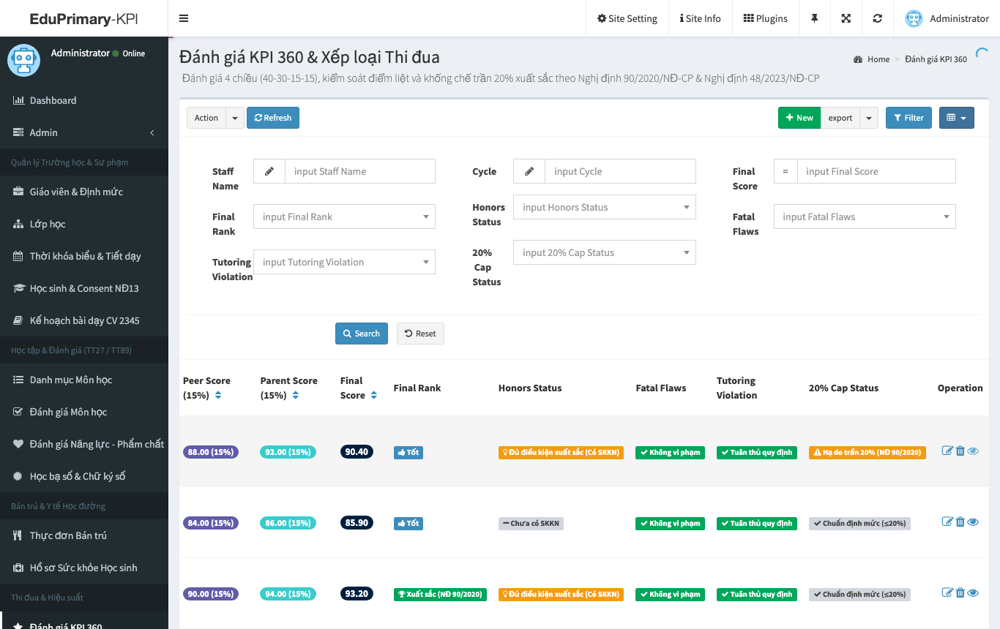

3. **Kiểm tra Điều kiện Điểm Liệt:**
   - Hệ thống tự động kích hoạt cờ `HasSevereViolation = true` và hạ xếp loại xuống **Không hoàn thành nhiệm vụ** nếu giáo viên:
     * Bị kỷ luật Đảng hoặc chính quyền trong năm học.
     * Vi phạm quy định cấm dạy thêm đối với học sinh tiểu học (Thông tư 29/2024 & Thông tư 19/2026).
     * Để xảy ra sự cố mất an toàn vệ sinh thực phẩm bán trú hoặc tai nạn thương tích học sinh nghiêm trọng.
4. **Kiểm tra Điều kiện Hoàn thành Xuất sắc:**
   - Điểm tổng hợp $\ge 90.0$ điểm **VÀ** phải có Sáng kiến kinh nghiệm / giải pháp đổi mới được cấp có thẩm quyền công nhận (`HasInitiative = true`). Nếu $\ge 90.0$ điểm mà không có sáng kiến thì hệ thống tự động chuyển sang mức **Hoàn thành tốt**.
5. **Thực thi Thuật toán Khống chế Trần 20% (20% Excellence Cap):**
   - Theo quy định, số viên chức "Hoàn thành xuất sắc nhiệm vụ" không vượt quá **20%** số viên chức được xếp loại "Hoàn thành tốt nhiệm vụ" trở lên:
     $$\text{Max\_Xuất\_Sắc} = \lfloor 0.20 \times (\text{Số lượng Đạt Tốt trở lên}) \rfloor$$
   - Khi chạy lệnh xét duyệt, hệ thống xếp thứ tự điểm từ cao xuống thấp. Các trường hợp đạt điểm $\ge 90$ nhưng nằm ngoài chỉ tiêu 20% sẽ được thuật toán tự động hạ về mức **Hoàn thành tốt nhiệm vụ**. BGH không cần tính toán thủ công bằng Excel.

## 3.5 Đóng băng Snapshot Học bạ & Ký số SmartCA Kèm TSA Timestamp

Để đảm bảo tính bất biến, chống sửa điểm hồi tố và chuẩn hóa dữ liệu kết xuất lên CSDL Ngành, BGH thực hiện quy trình đóng băng Snapshot học bạ số.

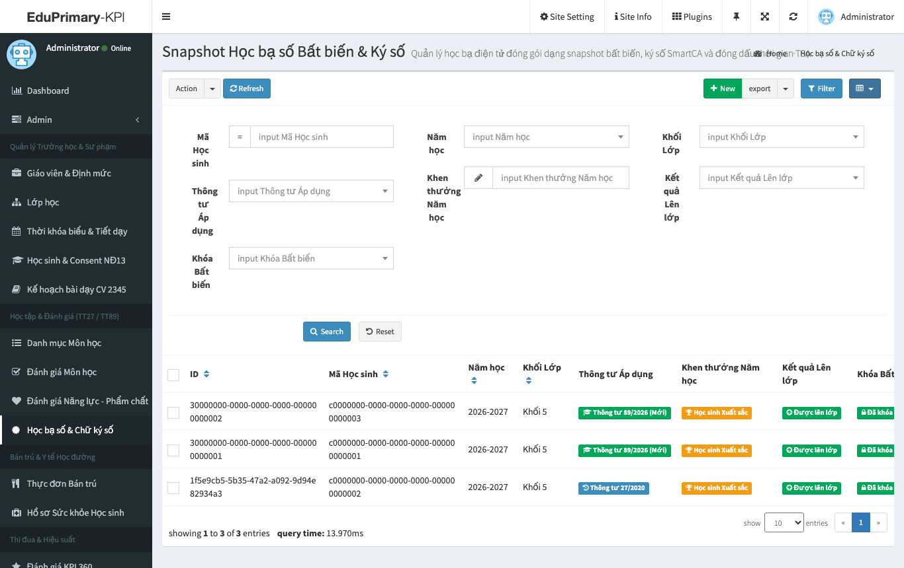

### Quy trình ký số phê duyệt học bạ số:
1. Truy cập: **Hồ sơ Học tập** -> **Học bạ Số (SmartCA Snapshot)** (`/admin/info/academic_transcripts_snapshots`).
2. Kiểm tra cờ cơ chế chuyển tiếp (**Strategy Versioning**):
   - Đánh giá trước ngày **01/12/2026**: Sử dụng quy chuẩn **Thông tư 27/2020/TT-BGDĐT**.
   - Đánh giá từ ngày **01/12/2026** trở đi: Hệ thống tự động chuyển đổi sang quy chuẩn **Thông tư 89/2026/TT-BGDĐT**.
3. Mở xem chi tiết bản ghi Snapshot:

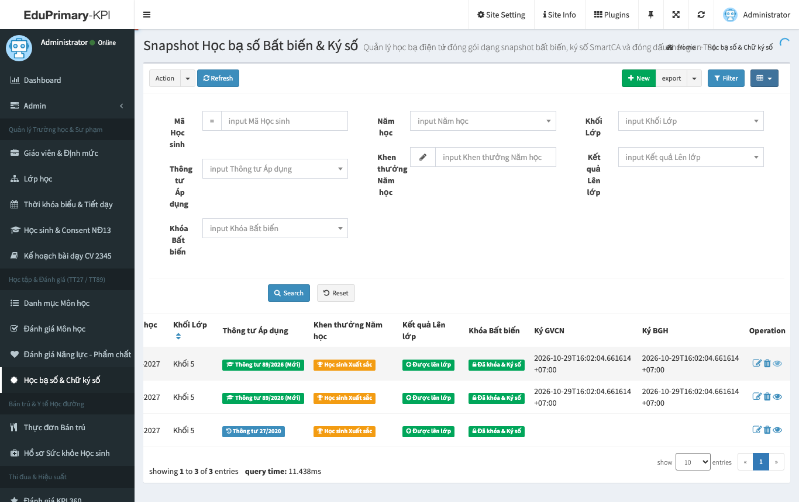

4. BGH cắm thiết bị ký số HSM / SmartCA, nhấn nút **Ký số Xác nhận (Sign with SmartCA)**.
5. Hệ thống gọi cổng ký số chuẩn quốc tế CMS/PKCS#7, kết nối với máy chủ Quốc gia cấp Dấu thời gian (**TSA Timestamp**) và gắn mã băm SHA-256 bất biến lên tệp học bạ.

## 3.6 Giám sát Cổng Tích hợp Sandbox Quốc gia

EduPrimary-KPI cung cấp bảng giám sát thời gian thực kết nối với 5 cổng dịch vụ công trực tuyến quốc gia:

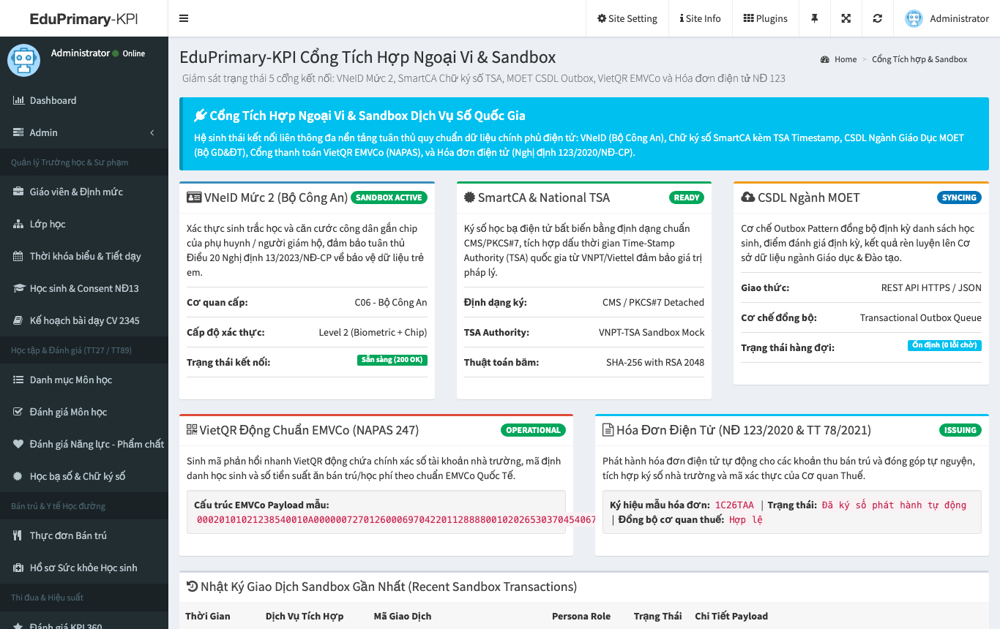

- **VNeID Mức 2 (Bộ Công An):** Xác minh căn cước công dân và liên kết định danh người giám hộ.
- **SmartCA & National TSA:** Trạng thái chứng thư số và máy chủ cấp dấu thời gian quốc gia.
- **CSDL Ngành MOET:** Hàng đợi tin nhắn Outbox đồng bộ dữ liệu học sinh lên Bộ GD&ĐT.
- **VietQR Động EMVCo (NAPAS 247):** Sinh mã thanh toán học phí tức thì cho từng học sinh.
- **Hóa đơn Điện tử (Nghị định 123):** Trạng thái cấp mã số hóa đơn thuế.

---

# 4. HƯỚNG DẪN DÀNH CHO GIÁO VIÊN CHỦ NHIỆM (GVCN)

Giáo viên chủ nhiệm là người quản lý toàn diện lớp học, giữ mối liên kết chặt chẽ giữa nhà trường và gia đình học sinh.

## 4.1 Quản lý Hồ sơ Học sinh & Lớp học

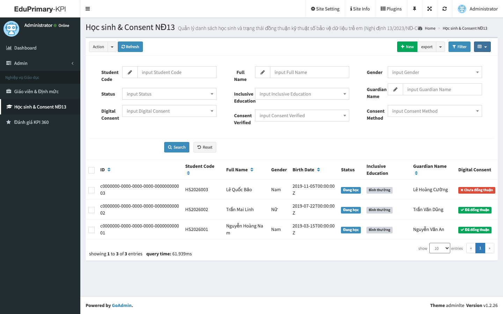

1. Truy cập: **Quản lý Học sinh** -> **Danh sách Học sinh** (`/admin/info/students`).
2. Xem danh sách học sinh thuộc lớp phụ trách (Ví dụ: Lớp 1A1, 2A1...).
3. Bấm vào học sinh để xem chi tiết lý lịch trích ngang, thông tin người giám hộ hợp pháp, số điện thoại khẩn cấp và địa chỉ cư trú:

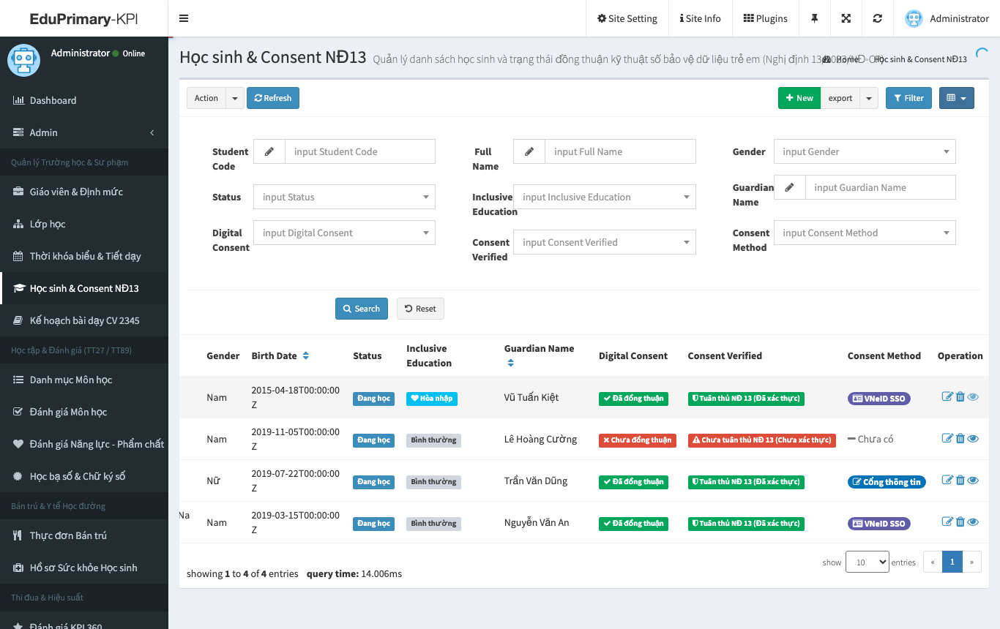

## 4.2 Rà soát Digital Consent Bảo vệ Trẻ em (Điều 20 NĐ 13/2023)

Theo quy định nghiêm ngặt tại **Điều 20 Nghị định số 13/2023/NĐ-CP** về Bảo vệ dữ liệu cá nhân trẻ em, nhà trường chỉ được phép lưu trữ, công bố hình ảnh và xử lý dữ liệu học bạ khi có sự đồng thuận được xác thực của cha mẹ hoặc người giám hộ hợp pháp.

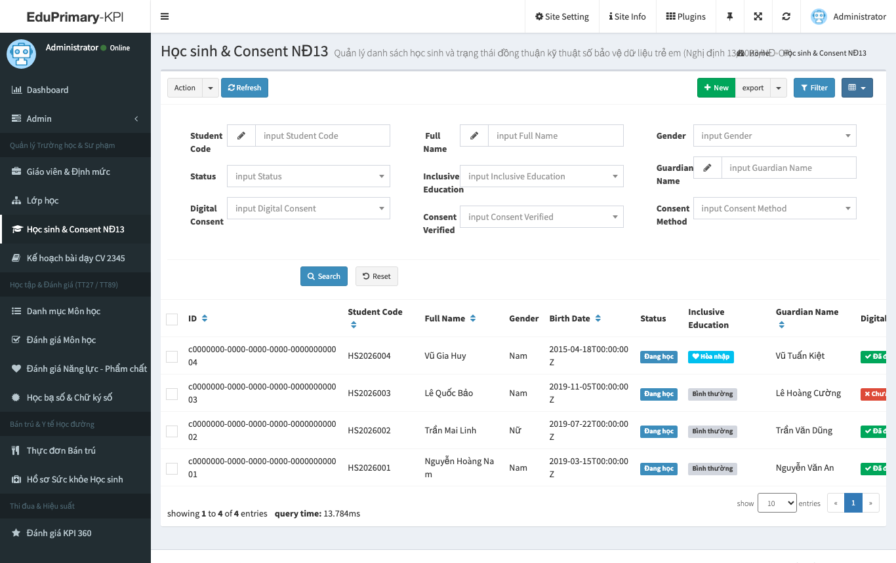

### Các bước theo dõi và xử lý:
1. Trên bảng danh sách học sinh, kiểm tra cột **Digital Consent (NĐ 13)**:
   - Màu xanh (`ĐÃ ĐỒNG THUẬN - CONSENTED`): Phụ huynh đã ký điện tử qua ứng dụng hoặc Cổng định danh VNeID Mức 2.
   - Màu đỏ (`CHƯA ĐỒNG THUẬN - PENDING`): Hồ sơ bị khóa tạm thời.
2. Với các học sinh chưa có đồng thuận, GVCN gửi thông báo nhắc nhở phụ huynh ký số trên ứng dụng.
3. *Lưu ý quan trọng:* Nếu GVCN hoặc Văn thư cố tình tạo mới hồ sơ học sinh hoặc nhập điểm khi `HasDigitalConsent = false`, hệ thống API sẽ từ chối xử lý và trả về mã lỗi **HTTP 422 Unprocessable Entity**.

## 4.3 Đánh giá Phẩm chất & Năng lực Học sinh (TT 27/2020 & TT 89/2026)

Hằng kỳ và cuối năm học, GVCN thực hiện đánh giá sự tiến bộ của học sinh về phẩm chất và năng lực theo quy chuẩn Thông tư 27 (hoặc Thông tư 89 tùy thời điểm):

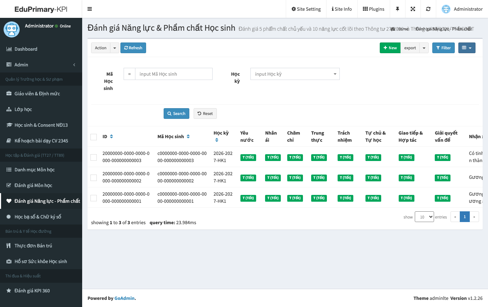

### Quy trình đánh giá:
1. Truy cập: **Đánh giá Học sinh** -> **Đánh giá Phẩm chất & Năng lực** (`/admin/info/student_behavior_evaluations`).
2. Chọn học sinh và tiến hành đánh giá 5 phẩm chất chủ yếu (Yêu nước, Nhân ái, Chăm chỉ, Trung thực, Trách nhiệm) và 10 năng lực cốt lõi theo 3 mức chuẩn:
   - **T (Tốt):** Học sinh đáp ứng tốt yêu cầu cần đạt, biểu hiện rõ nét và thường xuyên.
   - **Đ (Đạt):** Học sinh đáp ứng được yêu cầu cần đạt, có biểu hiện nhưng chưa thật thường xuyên.
   - **C (Cần cố gắng):** Học sinh chưa đáp ứng đầy đủ yêu cầu cần đạt, cần sự hỗ trợ của giáo viên.
3. Nhập lời nhận xét định tính cụ thể về sự tiến bộ, điểm nổi trội và biện pháp hỗ trợ từng em.

## 4.4 Tổng hợp Học bạ Số và Ký số Lớp Chủ nhiệm

Vào tuần cuối học kỳ, GVCN rà soát toàn bộ điểm các môn học do GVBM nhập, kiểm tra bảng đánh giá phẩm chất - năng lực và thực hiện ký số xác nhận học bạ trước khi trình Hiệu trưởng phê duyệt.

## 4.5 Quản lý Điểm danh & Báo suất Bán trú

Mỗi đầu buổi sáng (trước 07:45), GVCN thực hiện điểm danh học sinh hiện diện trên lớp:
- Học sinh vắng có phép hoặc không phép được ghi nhận vào hệ thống.
- Các trường hợp phụ huynh đã báo nghỉ và cắt cơm trên ứng dụng trước 08:00 sáng sẽ được hệ thống tự động đồng bộ sang bộ phận nhà bếp và kế toán để giảm trừ tiền ăn bán trú.

---

# 5. HƯỚNG DẪN DÀNH CHO GIÁO VIÊN BỘ MÔN (GVBM)

Giáo viên bộ môn (Toán, Tiếng Việt, Tiếng Anh, Tin học, GDTC, Âm nhạc, Mỹ thuật...) chịu trách nhiệm giảng dạy, nộp kế hoạch bài dạy và cập nhật kết quả học tập môn học.

## 5.1 Soạn thảo & Nộp Kế hoạch Bài dạy Chuẩn CV 2345

1. Truy cập: **Kế hoạch Bài dạy** -> Nhấn nút **Thêm mới Kế hoạch bài dạy**.
2. Nhập các thông tin bắt buộc:
   - Tên bài học, môn học, khối lớp, tuần dạy và số tiết.
   - Mục tiêu bài học (Về kiến thức, năng lực và phẩm chất).
   - Thiết bị dạy học và học liệu số.
   - Mô tả 4 hoạt động học tập (Khởi động, Khám phá, Luyện tập, Vận dụng).
   - Tích hợp nội dung STEM (nếu có).
3. Nhấn **Nộp bài dạy (Submit)** để chuyển hồ sơ lên Tổ trưởng chuyên môn thẩm định.

## 5.2 Nhập Điểm Kiểm tra Định kỳ & Trợ lý Nhận xét AI Copilot

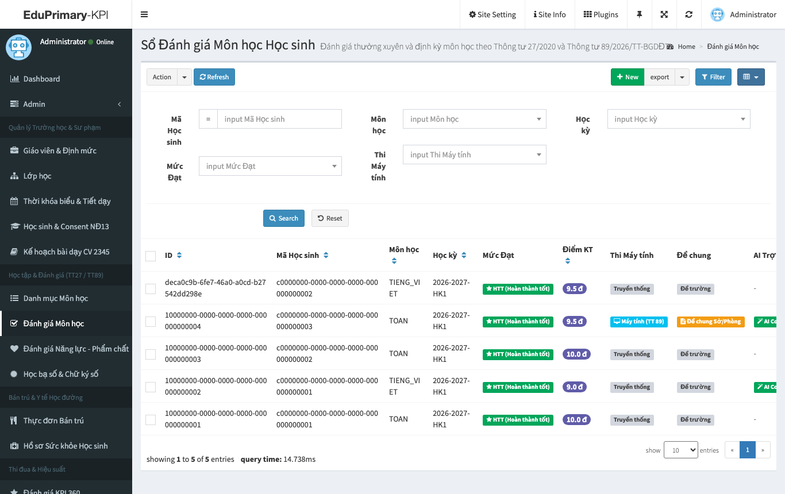

### Quy trình nhập điểm và nhận xét môn học:
1. Truy cập: **Đánh giá Học sinh** -> **Đánh giá Kết quả Môn học** (`/admin/info/student_subject_evaluations`).
2. Chọn lớp và môn học phụ trách (Ví dụ: Môn Toán - Lớp 3A1).
3. Nhập mức đạt chuẩn môn học:
   - `HTT`: Hoàn thành tốt.
   - `HT`: Hoàn thành.
   - `CHT`: Chưa hoàn thành.
4. Với các môn đánh giá có điểm kiểm tra định kỳ (Toán, Tiếng Việt, Tiếng Anh, Tin học): Nhập điểm số chính xác từ `1.0` đến `10.0` (hệ số 1 chữ số thập phân).
5. **Sử dụng Trợ lý Trí tuệ Nhân tạo (AI Copilot):**
   - Nhấn nút **Gợi ý nhận xét AI** bên cạnh ô nhận xét.
   - Trợ lý AI sẽ tự động phân tích điểm số, mức đạt và lịch sử rèn luyện để đề xuất câu nhận xét sư phạm giàu tính động viên, tuân thủ đúng tinh thần Thông tư 27/TT 89 (Không chê bai, chỉ rõ điểm tiến bộ và phương pháp rèn luyện thêm tại nhà).
   - Giáo viên có thể chỉnh sửa lời nhận xét trước khi nhấn **Lưu dữ liệu**.

## 5.3 Tra cứu Thời khóa biểu & Lịch Báo giảng

Giáo viên truy cập màn hình `/admin/timetable` để xem lịch dạy trong tuần, kiểm tra phòng chức năng và chuẩn bị thiết bị dạy học số tương ứng.

## 5.4 Tham gia Đánh giá Đồng nghiệp Trong Đánh giá KPI 360

Vào kỳ họp bình bầu cuối năm, mỗi giáo viên đăng nhập tài khoản để điền phiếu đánh giá kín cho các đồng nghiệp trong tổ chuyên môn. Điểm đánh giá đồng nghiệp chiếm tỷ trọng **15%** trong tổng điểm KPI của mỗi viên chức.

---

# 6. HƯỚNG DẪN DÀNH CHO KẾ TOÁN & TÀI CHÍNH

Bộ phận Kế toán chịu trách nhiệm vận hành công tác tài chính, thu học phí, quyết toán tiền ăn bán trú và chi trả thù lao vượt giờ.

## 6.1 Lập Kế hoạch Thực đơn Bán trú & Cân đối Dinh dưỡng Kcal, P:L:G

Theo khuyến nghị của Viện Dinh Dưỡng Quốc Gia và Bộ GD&ĐT, bữa ăn học đường tiểu học phải đảm bảo đầy đủ năng lượng và tỷ lệ cân đối giữa các nhóm dưỡng chất.

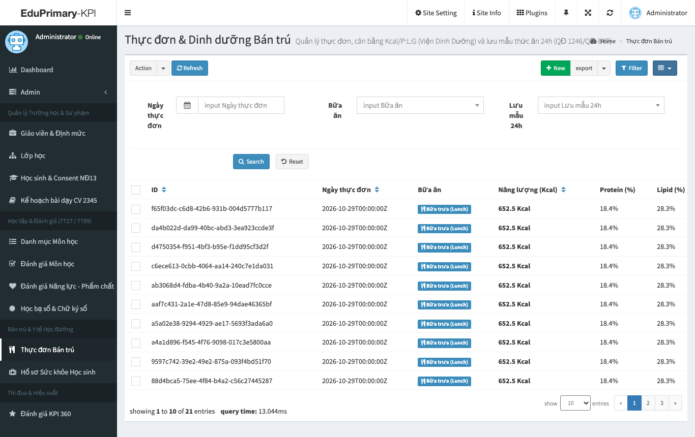

### Quy trình lập và kiểm soát thực đơn:
1. Truy cập: **Dinh dưỡng & Bán trú** -> **Thực đơn Bán trú** (`/admin/info/boarding_menus`).
2. Nhấn nút **Tạo thực đơn tuần mới**, nhập danh mục các món ăn (Bữa chính trưa và Bữa phụ xế).
3. Kiểm tra chi tiết chỉ số năng lượng do hệ thống tính toán tự động:

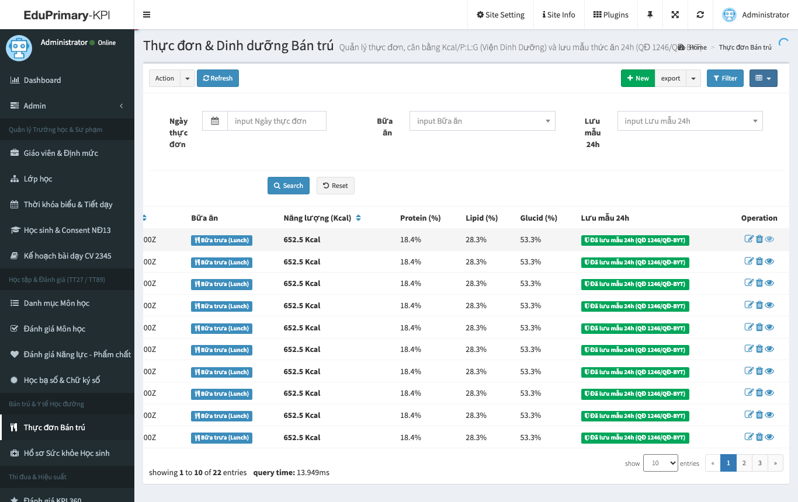

- **Tổng năng lượng chuẩn:** Dao động từ **650 - 750 Kcal/học sinh/bữa** (Ví dụ thực tế đạt: `718.2 Kcal`).
- **Tỷ lệ 3 nhóm sinh năng lượng (Protein : Lipid : Glucid):**
  * Protein (Đạm): **13 - 20%** (Thực tế đạt: `14.2%`).
  * Lipid (Chất béo): **20 - 30%** (Thực tế đạt: `26.5%`).
  * Glucid (Đường bột): **55 - 65%** (Thực tế đạt: `59.3%`).
4. Nếu chỉ số vượt ngoài ngưỡng an toàn, hệ thống sẽ cảnh báo bằng màu vàng/đỏ để kế toán điều chỉnh khối lượng nguyên liệu phù hợp.

## 6.2 Tự động Tính Tiền Ăn Bán trú & Quy tắc Cắt cơm Trước 08:00

Hệ thống thiết lập nguyên tắc quản lý suất ăn thông minh:
- **Đơn giá suất ăn bán trú:** Quy định thống nhất toàn trường: `35,000 VNĐ/học sinh/ngày`.
- **Nguyên tắc Cắt cơm Trước 08:00 Sáng:**
  * Nếu phụ huynh gửi yêu cầu cắt cơm trên ứng dụng **trước 08:00 sáng**, hệ thống tự động xác nhận `IsRefundEligible = true`, ghi nhận giảm 1 suất ăn trong ngày và hoàn trả đúng `35,000 VNĐ` vào tài khoản công nợ của học sinh cuối tháng.
  * Nếu phụ huynh báo cắt cơm **sau 08:00 sáng**, hệ thống từ chối hoàn tiền (`IsRefundEligible = false`) do nhà bếp đã tiến hành tiếp phẩm và chế biến thức ăn tươi sống.

## 6.3 Thu Phí Tự động Qua Mã VietQR Động Chuẩn EMVCo

Để xóa bỏ hoàn toàn việc thu tiền mặt tại trường, hệ thống sinh mã QR thanh toán động cho từng học sinh.

### Quy trình thu phí:
1. Hằng tháng, kế toán duyệt bảng kê các khoản thu (Tiền ăn bán trú, nước uống, bảo hiểm y tế).
2. Hệ thống gọi cổng thanh toán sandbox sinh mã **VietQR chuẩn EMVCo** kèm nội dung chuyển khoản định danh: `HP [Mã_Học_Sinh] [Tháng]`.
3. Phụ huynh quét mã trên bất kỳ ứng dụng ngân hàng nào (Napas 247).
4. Ngay khi tiền vào tài khoản ngân hàng của trường, Webhook ngân hàng tự động báo về hệ thống để **tự động gạch nợ**, xuất biên lai thu tiền điện tử gửi ngay cho phụ huynh.

## 6.4 Xuất Hóa đơn Điện tử Hợp pháp (NĐ 123/2020/NĐ-CP - Ký hiệu 1C26TAA)

Theo quy định tại **Nghị định 123/2020/NĐ-CP**, các khoản thu giáo dục phải được xuất hóa đơn điện tử hợp pháp:
- Hệ thống tích hợp sẵn cổng hóa đơn điện tử với ký hiệu mẫu số: `1C26TAA`.
- Sau khi gạch nợ thành công, kế toán nhấn nút **Ký phát hành Hóa đơn điện tử**. Hệ thống ký số và tự động truyền dữ liệu lên cơ quan thuế, đồng thời gửi mã tra cứu hóa đơn cho cha mẹ học sinh qua tin nhắn/email.

## 6.5 Quyết toán Thù lao Dạy Thừa giờ (Thông tư 05/2025/TT-BGDĐT)

Cuối năm học, kế toán truy cập bảng **Báo cáo Thừa giờ Giáo viên** (`screenshots/18_staff_detail.png`):
- Hệ thống tổng hợp chính xác số tiết thừa giờ thực tế của từng giáo viên theo đúng công thức Thông tư 05/2025 (không tính âm).
- Kế toán nhân với đơn giá tiền lương 1 tiết dạy quy đổi để lập bảng chi trả thù lao thêm giờ công khai, minh bạch.

---

# 7. HƯỚNG DẪN DÀNH CHO NHÂN VIÊN Y TẾ HỌC ĐƯỜNG

Nhân viên y tế học đường phụ trách chăm sóc sức khỏe ban đầu, theo dõi thể trạng học sinh và giám sát an toàn vệ sinh thực phẩm.

## 7.1 Theo dõi Nhân trắc học & Phân loại Thể trạng BMI

Đầu mỗi học kỳ, cán bộ y tế tổ chức cân đo chiều cao, cân nặng cho 100% học sinh toàn trường:

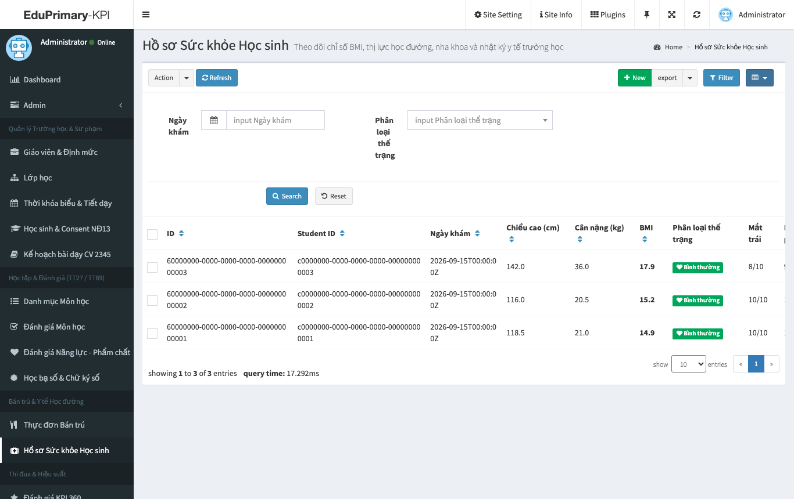

### Các bước thao tác:
1. Truy cập: **Y tế & Sức khỏe** -> **Hồ sơ Thể lực Học sinh** (`/admin/info/student_health_records`).
2. Chọn học sinh và nhập:
   - Chiều cao (cm) (Ví dụ: `118.5 cm`).
   - Cân nặng (kg) (Ví dụ: `21.4 kg`).
3. Hệ thống tự động tính toán chỉ số khối cơ thể (**BMI - Body Mass Index**):
   $$\text{BMI} = \frac{\text{Cân nặng (kg)}}{(\text{Chiều cao (m)})^2}$$
4. Hệ thống tự động đối chiếu biểu đồ tăng trưởng của Tổ chức Y tế Thế giới (WHO) theo độ tuổi và giới tính để xếp loại:
   - *Bình thường* (Normal weight).
   - *Gầy mòn / Suy dinh dưỡng* (Underweight).
   - *Nguy cơ thừa cân* (Overweight risk).
   - *Béo phì* (Obese).

## 7.2 Khám Chuyên khoa Thị lực, Nha học đường & Nhật ký Y tế

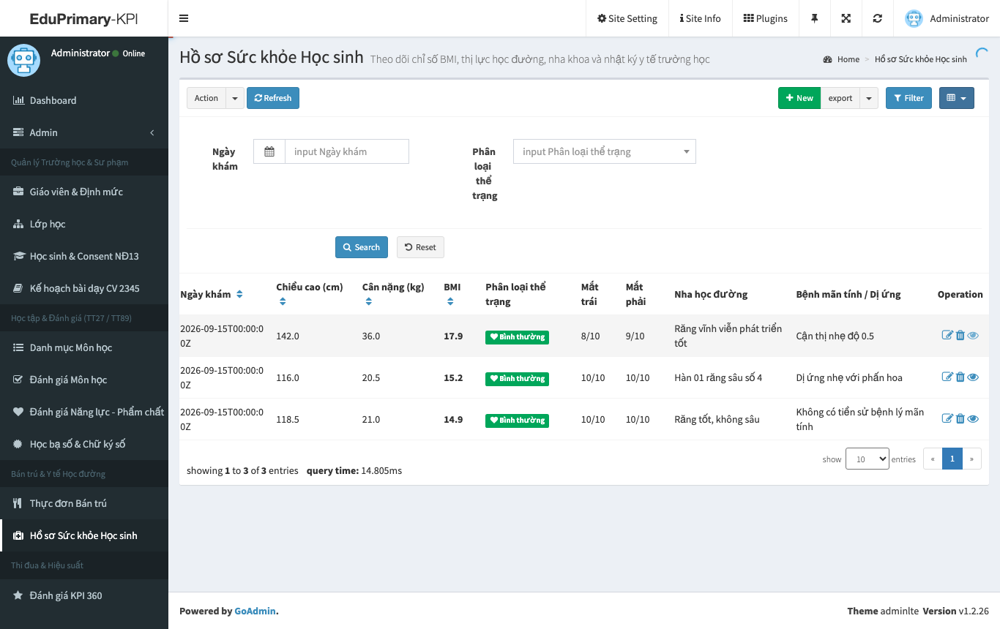

1. Ghi nhận kết quả đo thị lực mắt trái, mắt phải (Ví dụ: 10/10, hoặc cận thị 8/10).
2. Ghi nhận tình trạng răng miệng (Sâu răng, viêm lợi) và các dị ứng thuốc/thức ăn.
3. Khi học sinh bị sốt hoặc gặp sự cố tại trường, cán bộ y tế ghi nhật ký xử trí y tế ban đầu, thời gian chuyển giao viện hoặc thông báo phụ huynh.

## 7.3 Quy trình Tiếp nhận Đơn thuốc & Cấp phát Thuốc theo Yêu cầu

Nhằm ngăn chặn ngộ độc hoặc uống nhầm thuốc tại trường học:
- Phụ huynh chụp đơn thuốc của bác sĩ và gửi yêu cầu trên ứng dụng.
- Cán bộ y tế kiểm tra tên thuốc, liều lượng, hạn sử dụng trước khi tiếp nhận.
- Đúng giờ quy định (thường là sau giờ ăn trưa), cán bộ y tế gọi học sinh đến phòng y tế để cho uống thuốc, ký xác nhận vào sổ nhật ký và gửi thông báo đã uống thuốc cho phụ huynh.

## 7.4 Quy trình Niêm phong & Lưu mẫu Thức ăn 24H (QĐ 1246/QĐ-BYT)

Tuân thủ nghiêm ngặt **Quyết định số 1246/QĐ-BYT** của Bộ Y tế về kiểm thực 3 bước và lưu mẫu thức ăn:
1. **Thời điểm lấy mẫu:** Trước khi học sinh ăn 30 phút.
2. **Khối lượng mẫu:**
   - Món ăn đặc: Tối thiểu **100 gam/mẫu**.
   - Món canh/súp: Tối thiểu **150 ml/mẫu**.
3. **Dụng cụ lưu:** Hộp inox hoặc thủy tinh có nắp đậy kín, đã được tiệt trùng sạch sẽ.
4. **Niêm phong & Ghi nhãn:** Dán băng keo niêm phong có chữ ký của Kế toán, Bếp trưởng và Nhân viên y tế. Ghi rõ tên món, ngày giờ lấy mẫu, người lấy mẫu.
5. **Bảo quản:** Lưu trong tủ lạnh chuyên dụng ở nhiệt độ $2^\circ\text{C} - 4^\circ\text{C}$ trong vòng **24 giờ**.
6. **Hủy mẫu:** Sau 24 giờ nếu không xảy ra sự cố ATTP, cán bộ y tế cùng bếp trưởng lập biên bản hủy mẫu và ký xác nhận vào sổ kiểm thực bước 3.

---

# 8. HƯỚNG DẪN DÀNH CHO VĂN THƯ & QUẢN TRỊ HỆ THỐNG

Văn thư và Quản trị viên chịu trách nhiệm cấu hình danh mục, quản trị người dùng, sao lưu dữ liệu và truyền đồng bộ báo cáo lên cơ quan cấp trên.

## 8.1 Khởi tạo Danh mục Năm học, Khối lớp & Phòng học

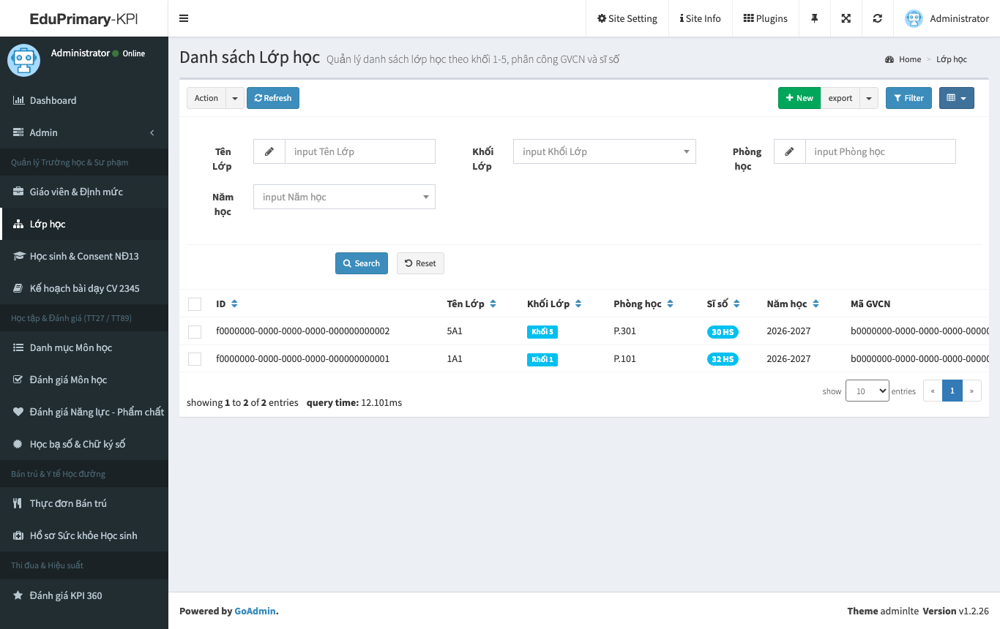

1. Truy cập: **Cấu hình Đơn vị** -> **Quản lý Lớp học** (`/admin/info/classes`).
2. Khai báo danh mục lớp từ Khối 1 đến Khối 5 (1A1, 1A2... 5A1).
3. Gán phòng học văn hóa, phòng chức năng (Tin học, Ngoại ngữ, Thể chất) và phân bổ sĩ số tối đa theo chuẩn trường chuẩn quốc gia (không quá 35 học sinh/lớp).

## 8.2 Quản lý Nhân sự Giáo viên & Phân công Chuyên môn

1. Thêm mới hồ sơ cán bộ, giáo viên vào hệ thống kèm mã số định danh viên chức.
2. Phân công giáo viên chủ nhiệm và giáo viên giảng dạy từng bộ môn theo năm học.

## 8.3 Tiếp nhận Hồ sơ Học sinh & Xác thực VNeID Mức 2

1. Nhập hồ sơ học sinh đầu cấp (tuyển sinh lớp 1) hoặc chuyển trường.
2. Kết nối Cổng xác thực định danh **VNeID Mức 2** (`screenshots/21_integrations_sandbox_stubs.png`) để tự động kiểm tra số định danh cá nhân 12 số của học sinh và cha mẹ từ Cơ sở dữ liệu Quốc gia về Dân cư.
3. Rà soát đảm bảo 100% học sinh có chữ ký đồng thuận Digital Consent trước khi chuyển giao danh sách cho GVCN.

## 8.4 Đồng bộ Dữ liệu CSDL Ngành MOET Qua Cơ chế Outbox

EduPrimary-KPI áp dụng mô hình thiết kế **Transactional Outbox Pattern** để đảm bảo dữ liệu đồng bộ lên Cơ sở dữ liệu Ngành của Bộ Giáo dục & Đào tạo không bao giờ bị thất lạc dù đường truyền mạng internet gặp sự cố:
- Mọi thay đổi về hồ sơ học sinh, điểm số môn học, kết quả học bạ được ghi nhận vào bảng hàng đợi `moet_outbox_queue`.
- Tiến trình Worker chạy ngầm tự động gửi các gói tin REST API chuẩn OpenAPI lên hệ thống CSDL Ngành MOET.
- Nếu mạng chập chờn, tiến trình áp dụng chiến lược thử lại lũy thừa (Exponential Backoff), đảm bảo tính toàn vẹn 100% khi đường truyền phục hồi.

## 8.5 Bảo mật, Sao lưu Cơ sở Dữ liệu & Phục hồi Thảm họa

- Hệ thống thực hiện sao lưu tự động cơ sở dữ liệu PostgreSQL hằng ngày vào lúc 01:00 sáng.
- Bản sao lưu được mã hóa chuẩn AES-256 và lưu trữ đồng thời tại máy chủ cục bộ và dịch vụ lưu trữ đám mây tách biệt.

---

# 9. HƯỚNG DẪN DÀNH CHO PHỤ HUYNH HỌC SINH

Phụ huynh sử dụng Cổng thông tin phụ huynh trên Web hoặc Ứng dụng di động để đồng hành cùng nhà trường trong quá trình học tập của con.

## 9.1 Xác thực Tài khoản Phụ huynh & Ký Digital Consent

1. Phụ huynh tải ứng dụng và đăng nhập bằng số điện thoại đã đăng ký với nhà trường (xác thực mã OTP hoặc qua tài khoản VNeID).
2. Khi mở ứng dụng lần đầu, màn hình hiển thị **Thỏa thuận Bảo vệ Dữ liệu Cá nhân Trẻ em (Điều 20 Nghị định 13/2023/NĐ-CP)**.
3. Phụ huynh đọc các điều khoản về phạm vi thu thập dữ liệu (Ảnh thẻ, mã định danh, hồ sơ sức khỏe, học bạ số) và nhấn nút **Đồng Ý và Ký Số Điện Tử**.
4. Chữ ký điện tử của phụ huynh được hệ thống mã hóa và lưu vào bảng `digital_consent_records`, mở khóa toàn quyền truy cập hồ sơ của con.

## 9.2 Theo dõi Kết quả Học tập, Rèn luyện & Sức khỏe Của Con

- Xem điểm kiểm tra định kỳ các môn học và lời nhận xét chi tiết của giáo viên bộ môn.
- Xem đánh giá 5 phẩm chất và 10 năng lực do GVCN cập nhật.
- Tra cứu chỉ số tăng trưởng thể lực (Chiều cao, cân nặng, chỉ số BMI) và kết quả khám thị lực mắt do nhân viên y tế cập nhật.

## 9.3 Báo Cắt Suất Ăn Bán trú Tự động Trước 08:00

1. Trong trường hợp học sinh bị ốm hoặc có việc bận gia đình cần nghỉ học, phụ huynh mở mục **Bán trú & Dinh dưỡng** trên ứng dụng.
2. Chọn ngày nghỉ và nhấn nút **Báo Nghỉ Ăn Bán Trú**.
3. **Quy định hoàn tiền:**
   - Nếu phụ huynh gửi trước **08:00 sáng**: Màn hình báo xác nhận *"Báo cắt cơm thành công — Được hoàn trả 35,000 VNĐ vào tiền ăn tháng sau"*.
   - Nếu gửi sau **08:00 sáng**: Màn hình thông báo *"Báo vắng thành công — Không hoàn tiền ăn do đã quá giờ chốt thực phẩm của bếp ăn"*.

## 9.4 Thanh toán Tiền ăn, Học phí Không Dùng Tiền Mặt (VietQR)

1. Khi nhà trường phát hành thông báo thu học phí hằng tháng, phụ huynh vào mục **Học phí & Tiền ăn**.
2. Bấm nút **Thanh toán ngay**: Màn hình hiển thị mã **VietQR** động tích hợp sẵn số tiền chính xác và mã học sinh.
3. Phụ huynh chụp màn hình hoặc chọn *"Mở ứng dụng ngân hàng"* để quét mã thanh toán Napas 247.
4. Giao dịch hoàn tất tức thì trong 2 giây, hệ thống cấp ngay biên lai điện tử và hóa đơn thuế điện tử để phụ huynh lưu trữ.

## 9.5 Gửi Yêu cầu Uống thuốc & Tương tác Với Cán bộ Y tế

1. Khi con cần uống thuốc tại trường, phụ huynh vào mục **Y tế học đường** -> **Gửi đơn thuốc**.
2. Chụp ảnh đơn thuốc của bác sĩ, nhập tên thuốc, liều lượng (Ví dụ: 1 viên sau ăn trưa) và lưu ý bảo quản.
3. Nhấn **Gửi tới Phòng Y tế Trường**. Cán bộ y tế sẽ tiếp nhận, cho học sinh uống thuốc đúng giờ và gửi tin nhắn phản hồi đã thực hiện cho phụ huynh an tâm.

---

# 10. PHỤ LỤC: BẢNG TRA CỨU MÃ LỖI VÀ RUNBOOK VẬN HÀNH

## 10.1 Bảng Tra cứu Mã Lỗi HTTP Nghiệp vụ

Khi thực hiện thao tác qua giao diện hoặc gọi API hệ thống, các lỗi nghiệp vụ pháp lý sẽ được trả về kèm thông điệp rõ ràng:

| Mã Lỗi HTTP | Tên Lỗi Kỹ Thuật | Nguyên Nhân Nghiệp Vụ Pháp Lý | Cách Xử Lý Khắc Phục |
|:---|:---|:---|:---|
| **409 Conflict** | `ERR_TIMETABLE_SLOT_CONFLICT` | Trùng tiết dạy thời khóa biểu: Giáo viên hoặc phòng học chức năng đã bị xếp lịch vào cùng 1 tiết trong tuần. | Kiểm tra lại thời khóa biểu, dời tiết dạy sang buổi học hoặc tiết học còn trống của giáo viên. |
| **422 Unprocessable Entity** | `ERR_DIGITAL_CONSENT_REQUIRED` | Vi phạm Điều 20 Nghị định 13/2023/NĐ-CP: Học sinh chưa hoàn thành ký đồng thuận điện tử từ cha mẹ/người giám hộ. | Liên hệ phụ huynh học sinh đăng nhập ứng dụng hoặc ký phiếu đồng thuận trước khi nhập dữ liệu. |
| **403 Forbidden** | `ERR_KPI_20PCT_EXCELLENCE_CAP_EXCEEDED` | Vi phạm Nghị định 90/2020 & 48/2023: Tỷ lệ xếp loại Hoàn thành xuất sắc vượt quá trần 20% tổng số người đạt Tốt trở lên. | Chạy thuật toán tự động cân đối trần hoặc hạ các cá nhân có điểm thấp hơn trong nhóm xuất sắc xuống nhóm Tốt. |
| **422 Unprocessable Entity** | `ERR_INITIATIVE_REQUIRED_FOR_EXCELLENCE` | Viên chức có điểm $\ge 90$ nhưng không có Sáng kiến kinh nghiệm / giải pháp đổi mới được cấp có thẩm quyền công nhận. | Bổ sung quyết định công nhận sáng kiến hoặc chuyển xếp loại xuống "Hoàn thành tốt nhiệm vụ". |
| **400 Bad Request** | `ERR_INVALID_SUBJECT_SCORE_RANGE` | Điểm kiểm tra định kỳ nằm ngoài khoảng hợp lệ `[1.0, 10.0]` theo Thông tư 27/2020 và Thông tư 89/2026. | Kiểm tra lại bảng điểm giấy và nhập đúng thang điểm 10.0. |
| **400 Bad Request** | `ERR_TEACHING_QUOTA_NEGATIVE` | Số tiết thừa giờ bị tính ra giá trị âm (trái quy tắc Thông tư 05/2025/TT-BGDĐT). | Hệ thống tự động giới hạn hàm $\max(0, \text{Tiết thừa})$, kiểm tra lại số tiết dạy quy đổi. |
| **404 Not Found** | `ERR_RESOURCE_NOT_FOUND` | Không tìm thấy mã định danh học sinh, giáo viên, lớp học hoặc thực đơn trong cơ sở dữ liệu. | Kiểm tra lại mã định danh tra cứu. |
| **401 Unauthorized** | `ERR_UNAUTHORIZED_ACCESS` | Phiên làm việc hết hạn hoặc chưa đăng nhập vào hệ thống GoAdmin. | Đăng nhập lại với tên người dùng và mật khẩu hợp lệ. |

## 10.2 Runbook Vận hành Hệ thống Định kỳ

Người quản trị hệ thống tuân thủ các quy trình vận hành đã được kiểm chứng tại `docs/runbooks/01-van-hanh-he-thong.md`:

```bash
# 1. Khởi động dịch vụ hệ thống EduPrimary-KPI
make run
# Hoặc khởi động trọn bộ cơ sở dữ liệu và API bằng Docker
make docker-up

# 2. Kiểm tra trạng thái sức khỏe máy chủ
curl -s http://localhost:8098/health | jq .

# 3. Chạy bộ kiểm thử tự động toàn diện
make test

# 4. Kiểm thử giao diện tự động E2E qua Playwright
make test-browser

# 5. Xác thực tài liệu và kiểm tra tham chiếu
make docs
```

## 10.3 Hỗ trợ Kỹ thuật & Khắc phục Sự cố 24/7

Khi gặp sự cố kỹ thuật hoặc cần tư vấn pháp lý nghiệp vụ trường học, vui lòng liên hệ:
- **Trung tâm Hỗ trợ Kỹ thuật EduPrimary-KPI:** Phòng CNTT Sở Giáo dục & Đào tạo / Đơn vị triển khai phần mềm.
- **Email tiếp nhận sự cố:** `hotro@eduprimary-kpi.edu.vn`
- **Đường dây nóng kỹ thuật 24/7:** `1900 - 6868` (Nhánh 1: Hỗ trợ phần mềm; Nhánh 2: Hỗ trợ ký số SmartCA và kết nối CSDL Ngành).

---
*Tài liệu được ban hành chính thức kèm theo quyết định phê duyệt triển khai phần mềm Quản lý Trường Tiểu học tích hợp KPI EduPrimary-KPI năm học 2026 - 2027.*
